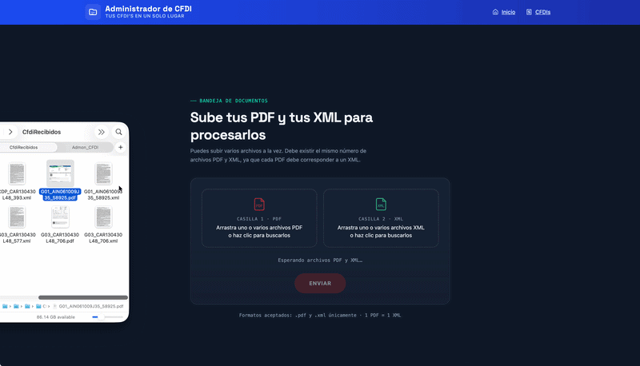
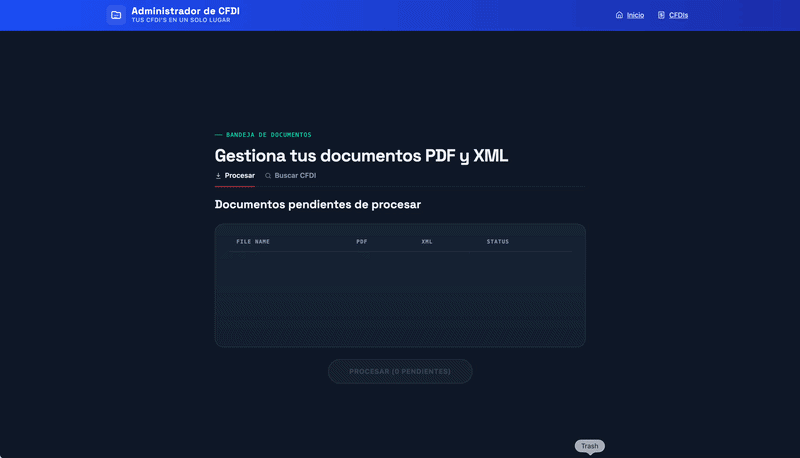
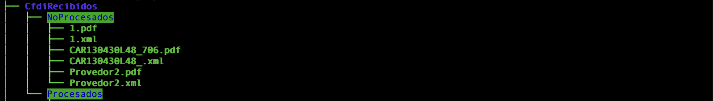

<div align="center">

# 📑 CFDI Admin — Docker Deployment

**Containerized deployment of CFDI Admin, a modern full-stack platform for processing, organizing, and querying Mexican Digital Tax Receipts (CFDI 4.0).**

[](https://openjdk.org/projects/jdk/17/)
[](https://spring.io/projects/spring-boot)
[](https://react.dev/)
[](https://www.typescriptlang.org/)
[](https://www.mysql.com/)
[](https://www.docker.com/)
[](LICENSE.md)

<p align="center">
  📚 Source code: <b><a href="https://github.com/jlpm-mex/cfdiadmon">cfdiadmon</a></b>
</p>

---

<p align="center">
  <a href="#about">About</a> •
  <a href="#demo--screenshots">Screenshots</a> •
  <a href="#deployment-architecture">Architecture</a> •
  <a href="#repository-structure">Repository Structure</a> •
  <a href="#features">Features</a> •
  <a href="#getting-started">Installation</a> •
  <a href="#configuration">Configuration</a> •
  <a href="#roadmap">Roadmap</a> •
  <a href="#license">License</a> •
  <a href="#author">Author</a>
</p>

</div>

---

## 📌 About

This repository contains the **Docker deployment configuration** for CFDI Admin. It does not hold the application source code — the backend JAR is pulled from the releases of the [cfdiadmon](https://github.com/jlpm-mex/cfdiadmon) repository, and the frontend bundle is served by Caddy.

**CFDI Admin** is a full-stack web application that automatically ingests, parses, validates, categorizes, and queries Mexican CFDI 4.0 files (XML + PDF pairs), making it easy for accounting teams to organize and search their electronic invoicing records.

Cloning this repository gives you everything required to run the application with Docker Compose.

---

## 📸 Demo / Screenshots

<div align="center">

### Main Dashboard (Ingestion & Processing)
*Drag-and-drop ingestion, pending file inspection, and batch execution status.*



<br/>

### Document Search & Filter Explorer
*Multi-criteria querying (by issue date, processing date, and supplier RFC) with instant data grid views.*



</div>

---

## 🏗 Deployment Architecture

Three containers run on a shared external Docker network (`spider`):

```
                        ┌─────────────────────────────────────┐
 Browser ──► cfdi_front │ Caddy (SPA + reverse proxy)         │
   :9087 (HTTP)  ──────►│  /  ──► static dist/ (React SPA)    │
   :9043 (HTTPS)         │  /api/* ──► cfdi_back:9081          │
                        └──────────────┬──────────────────────┘
                                       │
                        ┌──────────────▼──────────────────────┐
                        │ cfdi_back (Spring Boot, Java 17)    │
                        │  :9081 REST API                     │
                        │  • Scans CfdiRecibidos/ directories │
                        │  • Parses XML / PDF pairs           │
                        └──────────────┬──────────────────────┘
                                       │
                        ┌──────────────▼──────────────────────┐
                        │ mysql (MySQL 8 LTS)                 │
                        │  :3310 (host) → :3306 (container)   │
                        │  Schema: admon_cfdi                 │
                        └─────────────────────────────────────┘
```

| Container  | Role                                                        | Host Ports     |
| :--------- | :---------------------------------------------------------- | :------------- |
| `admoncfdifront` | Caddy serving the React SPA, proxies `/api/*` to the backend | `9087` (HTTP), `9043` (HTTPS, available for future TLS setup) |
| `admoncfdiback`  | Spring Boot REST API (Java 17)                              | `9081` |
| `mysqladmoncfdi` | MySQL 8 database with pre-initialized schema               | `3310` |

---

## 📂 Repository Structure

```
cfdiadmon_docker/
├── back/
│   ├── Dockerfile                     # Pulls the latest release JAR from cfdiadmon
│   └── resources/application.properties  # Overridable Spring configuration
├── front/
│   ├── Dockerfile                     # Caddy image with the built SPA
│   ├── dist/                          # Pre-built React bundle
│   └── resources/Caddyfile            # Static serving + /api reverse proxy
├── init_schema/
│   └── schema.sql                     # Executed on first MySQL start
├── data/                              # MySQL data volume (created at runtime)
├── conf/                              # Optional MySQL config (mounted as /etc/mysql/my.cnf)
├── CfdiRecibidos/                     # CFDI staging area (created at setup)
│   ├── NoProcesados/                  # Drop XML + PDF pairs here
│   └── Procesados/                    # Processed documents land here
├── .env                               # Docker Compose env (database password)
└── docker-compose.yml
```

---

## ✨ Features

- 📁 **Automated CFDI Pairing & Organization:** Synchronizes and correlates XML and PDF companion files automatically.
- 📅 **Dual-Date Search Indexing:** Filter receipts by both *Issue Date* and *System Processing Date*.
- 🏢 **Issuer & Taxpayer Lookup:** Fast query capabilities by Issuer RFC and Legal Name.
- 📤 **Drag & Drop Upload:** Seamless file upload interface with real-time upload progress bars.
- ⚡ **Batch Directory Ingestion:** Automatic scanning and processing of files directly from the `CfdiRecibidos` staging directories.

---

## 🚀 Getting Started

### Prerequisites

- [Docker](https://www.docker.com/) with [Docker Compose](https://docs.docker.com/compose/)
- [Git](https://git-scm.com/)

### Deployment Steps

1. **Clone this repository:**
   ```bash
   git clone https://github.com/jlpm-mex/cfdiadmon_docker.git
   cd cfdiadmon_docker
   ```

2. **Create the external Docker network used by the compose file:**
   ```bash
   docker network create spider
   ```

3. **Create the required staging directories:**
   ```bash
   mkdir -p CfdiRecibidos/NoProcesados CfdiRecibidos/Procesados conf
   ```
   > 💡 `conf/` is mounted as MySQL's `/etc/mysql/my.cnf`. It can be left empty (default configuration is used) or populated with a custom `my.cnf`.

4. **Secure the database (recommended):**
   - Edit `.env` and change the default password:
     ```properties
     mypasswd=your_strong_password
     ```
   - Update the matching value in `back/resources/application.properties`:
     ```properties
     spring.datasource.password=your_strong_password
     ```

5. **Start the stack:**
   ```bash
   docker compose up -d
   ```

6. **Access the application:**
   Open your browser and navigate to:
   ```text
   http://localhost:9087
   ```
   (or `http://<server-ip>:9087` when deployed on a remote host)

7. **Process your first batch:**
   - Place matching XML and PDF files into `CfdiRecibidos/NoProcesados` (or upload them via the web UI drag & drop).
   > ⚠️ **Note:** Each XML file must have a companion PDF with the exact same base filename to be paired correctly.

   

   - Click the **Process** button in the dashboard. Processed documents are moved to `CfdiRecibidos/Procesados`.

---

## ⚙️ Configuration

All runtime configuration lives in `back/resources/application.properties`, which is bind-mounted over the JAR's defaults:

| Property | Description |
| :--- | :--- |
| `spring.datasource.url` / `.username` / `.password` | MySQL connection settings (must match `.env` password) |
| `base.cfdi.path` / `unprocessed.path` / `processed.path` | Staging directories scanned for CFDI files |
| `server.port` | Backend REST port (default `9081`) |
| `upload.files.cross-origin` | Allowed origin for drag & drop uploads — set it to your deployment host when running remotely |
| `spring.ai.openai.api-key` | Optional API key to enable AI features |

---

## 🗺 Roadmap

- [ ] **Item-Level Concept Search:** Query and retrieve all CFDIs containing specific product/service concept descriptions.
- [ ] **AI-Powered Analytics & NLQ:** Integrate Spring AI / LLM capabilities for Natural Language Querying and Business Intelligence over invoice data.
- [ ] **Automated SAT Bulk Sync:** Direct integration with the SAT Web Service for automated bulk CFDI downloads.
- [ ] **Standalone XML Ingestion:** Support for standalone XML processing with on-the-fly PDF generation when source PDFs are unavailable.

---

## 📄 License

This project is open source and available under the [MIT License](LICENSE.md).

---

## 👤 Author

Developed by **jlpm-mex**

- GitHub: [@jlpm-mex](https://github.com/jlpm-mex)
- Source Code: [cfdiadmon](https://github.com/jlpm-mex/cfdiadmon)
- Docker Setup: [cfdiadmon_docker](https://github.com/jlpm-mex/cfdiadmon_docker)
